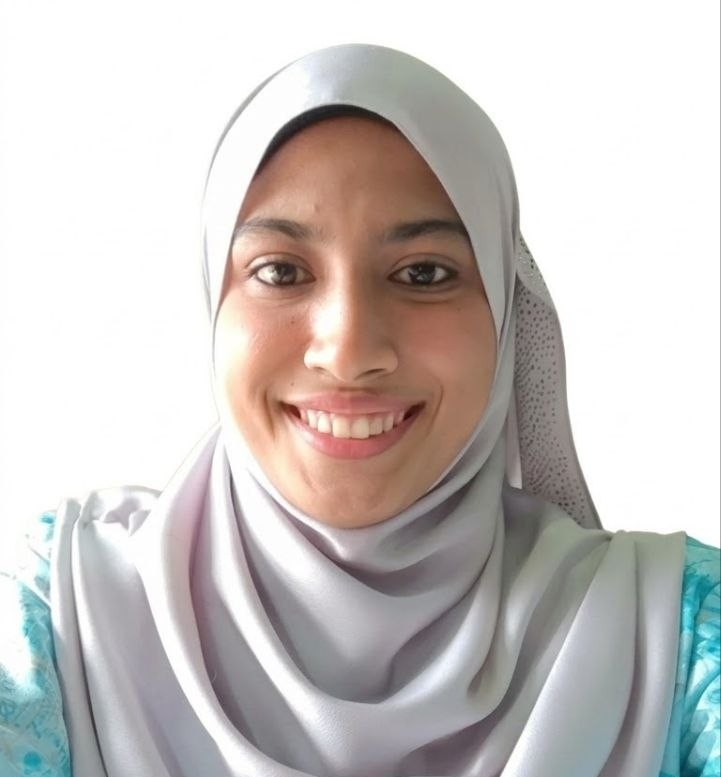

  

# Assalamualaikum & haloo, saya Khadijah Hedrah! 👋

### 👩‍💻 Info Saya
Saya baru sahaja memulakan perjalanan pembelajaran dalam bidang pengkomputeran. Saya berminat untuk mempelajari pembangunan perisian dan perkongsian projek secara terbuka. 

- 🔭 **Saya sedang membina:** Projek pertama saya di GitHub
- 🌱 **Saya sedang mempelajari:** HTML, CSS, JavaScript & Git/GitHub
- 💬 **Tanya saya tentang:** Apa yang dipelajari hari ni?
- 📝 **Tahap pengetahuan:** Asas
- 📫 **Cara hubungi saya:** khadijahhedrah@graduate.utm.my
---

### 🛠️ Kemahiran & Perkakas
- **Bahasa Pengaturcaraan:** HTML, CSS, JavaScript (contoh)
- **Alatan (Tools):** Git, GitHub, VS Code

---

### 📈 Statistik GitHub
*(Boleh ditambah kemudian apabila anda mula aktif)*
